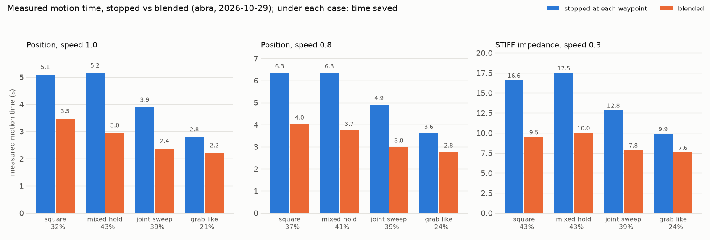

# Blended trajectories on the real Gen3 (abra, 2026-10-29)

Hardware results for RAMMP-CuRobo#47 (`/rammp_curobo/plan_through`, `/rammp_curobo/blend`).
Each case was planned leg by leg on the branch's planner, then sent to the driver's
`/execute_joint_trajectory` as **one goal** twice: once with every junction stopped
(blend radius 0) and once blended. So the "stopped" runs are already a single goal: they
don't include the ~0.85 s per junction that separate `go_to_*` calls add today (settle,
replanning, handover). Against today's code the saving is larger than shown here.

## Setup

- Arm: abra (dojo), flat mount; `sheppy up dojo-nightly` (nightly driver and planner).
- Planner: the nightly image with this branch built over it (`bench/Dockerfile.blend`), run as
  a second node, `rammp_curobo_blend`, beside the stock planner. Its world is
  `bench/world_keepout.yaml`: the bench world plus keep-out boxes around the clear workspace.
- Bench: `bench/track.py`, in that image on abra's host network.
  - Each leg is planned from the previous leg's end with `plan_to_pose` / `plan_to_joints`,
    then the legs are joined with `/blend`.
  - Before sending, it checks the whole tool and flange path against a clear box with its own
    URDF FK. It sends nothing if the path leaves the box.
  - It records the driver's feedback (`actual` at ~900 Hz) and `/joint_states`.
- Analysis: `bench/analyze.py`. The driver's feedback leaves `desired` empty, so errors are
  measured against the **plan**, started 12 ms after the goal was accepted (the start lag
  position mode shows).
  - "path dev": the tool's distance from the planned tool path, independent of timing.
  - "still": time the tool moved slower than 1 cm/s between its first and last motion.

Cases, all from HOME (tool at 0.577, 0.001, 0.434 m, pointing forward):

| case | legs | blend radii (cm) |
|---|---|---|
| square | vertical 30 x 20 cm square, HOLD_LEVEL | 3, 3, 3, 3 |
| mixed_hold | HOLD_LEVEL pose, free pose, joints, free pose, HOLD_LEVEL pose | 5, 5, 3, 3 |
| joint_sweep | five joint waypoints (J1 ±30°, J2, J4, J6, J7) | 5, 5, 5, 5 |
| grab_like | view (free), pre-grasp (LEVEL), grasp (FIXED), raise (LEVEL) | 5, 1, 0 |

## Findings

- **Position mode tracks cleanly from 0.3 to full speed, stopped or blended.** At 1.0:
  - worst joint error 0.45–0.63°, tool within 5.2–7.4 mm of the plan;
  - the blended path strays at most 6 mm from the planned path, against 4 mm when stopped;
  - blending saves 21–43 % of the motion time.
- **Corners:** the radius is a bound, not a target.
  - At full speed the square's 3 cm radius cut 0.7–2.7 cm (0.9–2.9 cm at 0.8). Which check stopped
    each overlap wasn't recorded, and `corner_m` is an upper bound, which also shrinks the cuts.
  - The pre-grasp's 1 cm radius cut 0.9 cm.
- **STIFF impedance only tracks at 0.3.** There the arm runs 5–9° behind the plan, 11–25 mm
  off the path, and blending still saves 24–43 %.
  - From 0.5 up, the arm falls behind until the 0.35 rad path tolerance trips, stopped or blended.
  - The one exception: `joint_sweep` at 0.5 tracked stopped but tripped blended, because the
    legs' velocities add in the overlap.
  - Under impedance the arm sags at HOME: the planner logged 2.53° of tilt, more than HOLD_LEVEL's
    2° start check. So `mixed_hold` stopped at mixed speeds could not be planned
    (`CONSTRAINT_UNSATISFIABLE`). Its blended run was planned and aborted.
- **Late start, once:** one goal (`full10/square_1_stop`) started 263 ms after the driver accepted
  it. Its row in the tables, measured from the accept time, shows 17.9° and 125 mm. Aligned to its
  real start (`bench/lagcheck.py` fits the start offset), it tracked within 0.51°.
- **Not covered on hardware:** `plan_through` itself and `straight` legs. Every case went through
  `/blend`.

Per-run figures: `figures/<set>/<case>.png`, with tool speed planned vs measured, tool error
vs the plan, and distance from the planned path. `figures/video10` is the filmed run.

## Re-run on 80b19b6 (after review): `v2_10`

The same suite, position mode at speed 1.0, on the reviewed planner. Each leg's hold now goes
to `/blend`, which keeps a held leg's hold through its overlaps; `corner_m` is now how close the
tool came to each goal. All 8 runs succeeded.

| case | stopped | blended | saved (before the fixes, video10) |
|---|---|---|---|
| square (LEVEL) | 5.01 s | 3.77 s | 25 % (32 %) |
| mixed_hold | 4.63 s | 3.89 s | 16 % (43 %) |
| joint_sweep | 3.89 s | 2.45 s | 37 % (39 %) |
| grab_like | 2.82 s | 2.31 s | 18 % (21 %) |

- Tracking is unchanged: worst joint error 0.45–0.69°, tool within 6.3 mm of the plan, at most
  4.9 mm from the planned path.
- Level deviation in the square (HOLD_LEVEL throughout), with the planner's own metric
  (`bench/tilt.py`):

  | run | planned stopped | planned blended | measured stopped | measured blended |
  |---|---|---|---|---|
  | before the fixes (video10) | 0.64° | 1.22° | 1.00° | 1.25° |
  | after the fixes (v2_10) | 0.61° | 0.47° | 1.03° | 1.02° |

  The blend is now as level as stopping; the measured ~1° is tracking.
- Savings shrank where legs are held (the hold limits the overlap), as expected.

## A second run on 80b19b6: `v2_10b`

The same suite again, for repeatability. All 8 runs succeeded.

| case | stopped | blended | saved |
|---|---|---|---|
| square (LEVEL) | 5.15 s | 3.77 s | 27 % |
| mixed_hold | 5.23 s | 3.49 s | 33 % |
| joint_sweep | 3.89 s | 2.45 s | 37 % |
| grab_like | 2.92 s | 2.20 s | 25 % |

The held cases vary most between runs (`mixed_hold` went from 16 % to 33 %), because cuRobo plans different legs on each call. The stopped baseline moved from 4.63 s to 5.23 s.

## On d8db5c3 (holds checked against each leg's goal orientation): `v3`

The bench now sends each held leg's goal orientation (`Blend.hold_orientation`), and adds two cases:
- `pose_mix`: poses held LEVEL, free, free, LEVEL.
- `level_turn`: LEVEL legs whose second goal is turned 40° about the vertical, a turn LEVEL leaves free in transit.

Each ran at speeds 0.5 and 1.0. All 20 runs succeeded.

| case | 0.5 stopped → blended | saved | 1.0 stopped → blended | saved |
|---|---|---|---|---|
| square (LEVEL) | 9.57 → 7.09 s | 26 % | 4.97 → 3.81 s | 23 % |
| pose_mix | 7.90 → 5.81 s | 26 % | 3.76 → 3.06 s | 19 % |
| level_turn | 10.26 → 6.33 s | 38 % | 4.43 → 3.57 s | 19 % |
| joint_sweep | 7.76 → 4.79 s | 38 % | 3.89 → 2.45 s | 37 % |
| grab_like | 5.53 → 4.45 s | 20 % | 2.84 → 2.28 s | 20 % |

- **Tracking:** the worst joint error was under 0.7° everywhere except one stopped run (`pose_mix` at 0.5, 1.18°). The tool stayed within 7.4 mm of the plan and 4.9 mm of the path.
- **Level holds:** the planned deviation stayed within 1.4° of level. In `level_turn` at full speed the blend overlapped the 40° turn with the level move (1.38° planned, 1.32° measured).
- **Standstill inside the motion:** stopped runs 0.07–0.84 s; blended runs 0–0.13 s.

## Tables

**video10**

| run | result | planned s | ran s | motion s | still s | joint max ° | joint RMS ° | tool max mm | path dev max mm | corners cm |
|---|---|---|---|---|---|---|---|---|---|---|
| grab_like_1_blend | ok | 2.28 | 2.27 | 2.21 | 0.04 | 0.63 | 0.154 | 5.55 | 3.73 | 3.49, 0.88, 0 |
| grab_like_1_stop | ok | 2.88 | 2.87 | 2.8 | 0.06 | 0.564 | 0.143 | 5.86 | 3.15 | 0, 0, 0 |
| joint_sweep_1_blend | ok | 2.42 | 2.41 | 2.37 | 0.0 | 0.497 | 0.14 | 5.29 | 5.04 | 2.47, 1.74, 2.29, 3.14 |
| joint_sweep_1_stop | ok | 3.94 | 3.93 | 3.89 | 0.14 | 0.453 | 0.109 | 5.41 | 4.27 | 0, 0, 0, 0 |
| mixed_hold_1_blend | ok | 3.04 | 3.03 | 2.95 | 0.0 | 0.618 | 0.163 | 6.42 | 6.0 | 4.85, 4.26, 2.33, 1.22 |
| mixed_hold_1_stop | ok | 5.24 | 5.23 | 5.15 | 0.17 | 0.471 | 0.14 | 5.44 | 3.87 | 0, 0, 0, 0 |
| square_1_blend | ok | 3.52 | 3.51 | 3.47 | 0.02 | 0.624 | 0.182 | 5.2 | 4.06 | 2.61, 1.13, 0.71, 2.72 |
| square_1_stop | ok | 5.14 | 5.13 | 5.09 | 0.21 | 0.533 | 0.159 | 5.36 | 3.46 | 0, 0, 0, 0 |

**full10**

| run | result | planned s | ran s | motion s | still s | joint max ° | joint RMS ° | tool max mm | path dev max mm | corners cm |
|---|---|---|---|---|---|---|---|---|---|---|
| grab_like_1_blend | ok | 2.3 | 2.29 | 2.23 | 0.03 | 0.508 | 0.138 | 6.41 | 4.02 | 3.02, 0.91, 0 |
| grab_like_1_stop | ok | 2.94 | 2.93 | 2.86 | 0.09 | 0.527 | 0.131 | 7.23 | 3.12 | 0, 0, 0 |
| joint_sweep_1_blend | ok | 2.42 | 2.41 | 2.37 | 0.0 | 0.473 | 0.143 | 5.78 | 4.92 | 2.47, 1.74, 2.29, 3.13 |
| joint_sweep_1_stop | ok | 3.94 | 3.93 | 3.89 | 0.13 | 0.606 | 0.125 | 7.38 | 4.14 | 0, 0, 0, 0 |
| mixed_hold_1_blend | ok | 3.06 | 3.05 | 2.97 | 0.0 | 0.607 | 0.158 | 6.34 | 6.06 | 4.87, 3.67, 2.32, 1.24 |
| mixed_hold_1_stop | ok | 5.16 | 5.15 | 5.08 | 0.16 | 0.545 | 0.145 | 5.99 | 3.84 | 0, 0, 0, 0 |
| square_1_blend | ok | 3.5 | 3.49 | 3.43 | 0.0 | 0.568 | 0.16 | 6.02 | 4.51 | 2.76, 0.81, 0.61, 2.93 |
| square_1_stop | ok | 4.98 | 5.22 | 4.93 | 0.17 | 17.854 | 7.973 | 124.71 | 3.44 | 0, 0, 0, 0 |

**s08**

| run | result | planned s | ran s | motion s | still s | joint max ° | joint RMS ° | tool max mm | path dev max mm | corners cm |
|---|---|---|---|---|---|---|---|---|---|---|
| grab_like_0.8_blend | ok | 2.84 | 2.83 | 2.75 | 0.05 | 0.363 | 0.104 | 5.0 | 2.86 | 3.47, 1, 0 |
| grab_like_0.8_stop | ok | 3.68 | 3.67 | 3.6 | 0.18 | 0.414 | 0.106 | 4.84 | 2.26 | 0, 0, 0 |
| joint_sweep_0.8_blend | ok | 3.04 | 3.03 | 2.98 | 0.0 | 0.421 | 0.115 | 5.19 | 3.62 | 2.46, 1.69, 2.38, 3.26 |
| joint_sweep_0.8_stop | ok | 4.96 | 4.95 | 4.9 | 0.25 | 0.348 | 0.085 | 4.13 | 2.87 | 0, 0, 0, 0 |
| mixed_hold_0.8_blend | ok | 3.84 | 3.83 | 3.73 | 0.0 | 0.395 | 0.112 | 5.36 | 4.34 | 4.69, 3.65, 2.61, 1.31 |
| mixed_hold_0.8_stop | ok | 6.44 | 6.43 | 6.34 | 0.29 | 0.411 | 0.112 | 4.91 | 2.73 | 0, 0, 0, 0 |
| square_0.8_blend | ok | 4.1 | 4.09 | 4.02 | 0.0 | 0.384 | 0.137 | 4.62 | 3.56 | 2.92, 1.56, 0.89, 2.93 |
| square_0.8_stop | ok | 6.44 | 6.43 | 6.34 | 0.36 | 0.408 | 0.124 | 4.16 | 2.45 | 0, 0, 0, 0 |

**stiff**

| run | result | planned s | ran s | motion s | still s | joint max ° | joint RMS ° | tool max mm | path dev max mm | corners cm |
|---|---|---|---|---|---|---|---|---|---|---|
| grab_like_0.3_blend | ok | 7.66 | 7.65 | 7.56 | 0.07 | 9.171 | 2.194 | 33.88 | 19.43 | 3.52, 0.94, 0 |
| grab_like_0.3_stop | ok | 9.98 | 9.97 | 9.89 | 0.34 | 7.415 | 1.729 | 18.25 | 17.19 | 0, 0, 0 |
| grab_like_0.5_blend | aborted (-4) | 4.54 | 2.0 | 1.95 | 0.0 | 19.542 | 3.681 | 38.33 | 32.51 | 3.45, 0.96, 0 |
| grab_like_0.5_stop | aborted (-4) | 5.9 | 2.4 | 2.32 | 0.0 | 19.573 | 3.55 | 52.78 | 27.7 | 0, 0, 0 |
| grab_like_mixed_blend | aborted (-4) | 3.94 | 1.76 | 1.77 | 0.06 | 19.742 | 4.783 | 84.28 | 64.21 | 4.92, 1, 0 |
| grab_like_mixed_stop | aborted (-4) | 5.18 | 0.54 | 0.55 | 0.05 | 19.066 | 4.035 | 20.67 | 15.45 | 0, 0, 0 |
| joint_sweep_0.3_blend | ok | 8.02 | 8.01 | 7.84 | 0.01 | 7.016 | 1.543 | 30.17 | 25.38 | 2.62, 1.78, 2.4, 3.29 |
| joint_sweep_0.3_stop | ok | 13.1 | 13.09 | 12.82 | 0.74 | 5.237 | 1.167 | 32.45 | 21.16 | 0, 0, 0, 0 |
| joint_sweep_0.5_blend | aborted (-4) | 4.82 | 3.81 | 3.7 | 0.0 | 19.628 | 3.202 | 68.3 | 44.33 | 2.47, 1.74, 2.33, 3.32 |
| joint_sweep_0.5_stop | ok | 7.86 | 7.85 | 7.76 | 0.08 | 14.323 | 2.816 | 54.22 | 35.19 | 0, 0, 0, 0 |
| joint_sweep_mixed_blend | aborted (-4) | 3.88 | 1.69 | 1.66 | 0.0 | 19.462 | 4.413 | 129.18 | 56.52 | 2.8, 2.08, 0.97, 1.51 |
| joint_sweep_mixed_stop | aborted (-4) | 6.22 | 2.88 | 2.85 | 0.0 | 19.423 | 3.191 | 116.84 | 49.69 | 0, 0, 0, 0 |
| mixed_hold_0.3_blend | ok | 10.2 | 10.19 | 10.01 | 0.1 | 7.65 | 2.191 | 28.54 | 12.11 | 4.99, 3.78, 2.56, 1.35 |
| mixed_hold_0.3_stop | ok | 17.72 | 17.71 | 17.48 | 0.77 | 6.279 | 1.537 | 24.48 | 15.72 | 0, 0, 0, 0 |
| mixed_hold_0.5_blend | aborted (-4) | 6.2 | 2.05 | 1.97 | 0.0 | 19.594 | 4.422 | 42.74 | 16.67 | 4.8, 3.67, 2.41, 1.34 |
| mixed_hold_0.5_stop | aborted (-4) | 10.46 | 2.38 | 2.26 | 0.0 | 19.569 | 4.357 | 59.76 | 53.63 | 0, 0, 0, 0 |
| mixed_hold_mixed_blend | aborted (-4) | 5.6 | 1.74 | 1.7 | 0.0 | 19.677 | 6.118 | 80.78 | 54.84 | 2.51, 1.96, 2.87, 2.97 |
| square_0.3_blend | ok | 9.6 | 9.59 | 9.48 | 0.0 | 8.852 | 2.186 | 15.45 | 10.89 | 2.88, 1.67, 2.05, 3 |
| square_0.3_stop | ok | 16.8 | 16.79 | 16.58 | 0.67 | 7.417 | 1.956 | 20.03 | 15.05 | 0, 0, 0, 0 |
| square_0.5_blend | aborted (-4) | 6.56 | 1.83 | 1.77 | 0.0 | 19.619 | 4.26 | 49.81 | 31.98 | 2.89, 1.66, 0.85, 2.95 |
| square_0.5_stop | aborted (-4) | 10.38 | 2.0 | 1.9 | 0.0 | 19.603 | 4.51 | 55.27 | 55.22 | 0, 0, 0, 0 |
| square_mixed_blend | aborted (-4) | 7.94 | 3.0 | 2.96 | 0.0 | 19.149 | 6.568 | 103.19 | 79.73 | 1.46, 0.21, 0.11, 0.54 |
| square_mixed_stop | aborted (-4) | 9.98 | 0.48 | 0.44 | 0.0 | 19.377 | 5.802 | 31.85 | 9.24 | 0, 0, 0, 0 |

Sets: `video10` and `full10`: position mode, speed 1.0 (two runs of the same suite).
`s08`: position mode, 0.8. `stiff`: STIFF impedance at 0.3, 0.5 and mixed (1.0 / 0.4 per
leg). Aborted runs ran for `ran s` before the driver stopped the arm.

**v2_10**

| run | result | planned s | ran s | motion s | still s | joint max ° | joint RMS ° | tool max mm | path dev max mm | corners cm |
|---|---|---|---|---|---|---|---|---|---|---|
| grab_like_1_blend | ok | 2.38 | 2.37 | 2.31 | 0.04 | 0.658 | 0.159 | 5.43 | 4.24 | 4.87, 0.17, 0 |
| grab_like_1_stop | ok | 2.9 | 2.89 | 2.82 | 0.09 | 0.545 | 0.134 | 6.31 | 3.08 | 0, 0, 0 |
| joint_sweep_1_blend | ok | 2.5 | 2.49 | 2.45 | 0.0 | 0.468 | 0.14 | 5.46 | 4.85 | 3.2, 2.22, 2.94, 4.09 |
| joint_sweep_1_stop | ok | 3.94 | 3.93 | 3.89 | 0.13 | 0.452 | 0.11 | 5.0 | 4.15 | 0, 0, 0, 0 |
| mixed_hold_1_blend | ok | 3.98 | 3.97 | 3.89 | 0.0 | 0.553 | 0.162 | 6.04 | 4.63 | 1.1, 4.95, 1.94, 1.8 |
| mixed_hold_1_stop | ok | 4.72 | 4.71 | 4.63 | 0.15 | 0.621 | 0.15 | 5.57 | 3.91 | 0, 0, 0, 0 |
| square_1_blend | ok | 3.82 | 3.81 | 3.77 | 0.01 | 0.689 | 0.185 | 5.35 | 4.03 | 2.87, 1.31, 1.63, 1.38 |
| square_1_stop | ok | 5.08 | 5.07 | 5.01 | 0.2 | 0.495 | 0.156 | 5.56 | 3.06 | 0, 0, 0, 0 |

**v2_10b**

| run | result | planned s | ran s | motion s | still s | joint max ° | joint RMS ° | tool max mm | path dev max mm | corners cm |
|---|---|---|---|---|---|---|---|---|---|---|
| grab_like_1_blend | ok | 2.26 | 2.25 | 2.2 | 0.05 | 0.636 | 0.147 | 5.82 | 4.82 | 4.71, 0.42, 0 |
| grab_like_1_stop | ok | 3.0 | 2.99 | 2.92 | 0.1 | 0.488 | 0.129 | 6.64 | 3.05 | 0, 0, 0 |
| joint_sweep_1_blend | ok | 2.5 | 2.49 | 2.45 | 0.0 | 0.554 | 0.139 | 4.96 | 4.91 | 3.21, 2.24, 2.95, 4.08 |
| joint_sweep_1_stop | ok | 3.94 | 3.93 | 3.89 | 0.14 | 0.453 | 0.11 | 4.9 | 4.29 | 0, 0, 0, 0 |
| mixed_hold_1_blend | ok | 3.58 | 3.57 | 3.49 | 0.0 | 0.66 | 0.171 | 5.94 | 5.94 | 0.98, 4.91, 2.98, 1.63 |
| mixed_hold_1_stop | ok | 5.32 | 5.31 | 5.23 | 0.18 | 0.48 | 0.138 | 5.59 | 3.8 | 0, 0, 0, 0 |
| square_1_blend | ok | 3.82 | 3.81 | 3.77 | 0.01 | 0.663 | 0.183 | 5.81 | 4.27 | 2.86, 1.33, 0.72, 0.6 |
| square_1_stop | ok | 5.22 | 5.21 | 5.15 | 0.18 | 0.534 | 0.153 | 5.62 | 3.53 | 0, 0, 0, 0 |

**v3**

| run | result | planned s | ran s | motion s | still s | joint max ° | joint RMS ° | tool max mm | path dev max mm | corners cm |
|---|---|---|---|---|---|---|---|---|---|---|
| grab_like_0.5_blend | ok | 4.6 | 4.59 | 4.45 | 0.13 | 0.245 | 0.062 | 3.26 | 1.75 | 4.99, 0.17, 0 |
| grab_like_0.5_stop | ok | 5.7 | 5.69 | 5.53 | 0.41 | 0.251 | 0.06 | 3.51 | 1.23 | 0, 0, 0 |
| grab_like_1_blend | ok | 2.36 | 2.35 | 2.28 | 0.03 | 0.664 | 0.146 | 6.36 | 4.47 | 4.55, 0.22, 0 |
| grab_like_1_stop | ok | 2.92 | 2.91 | 2.84 | 0.07 | 0.522 | 0.137 | 7.35 | 3.13 | 0, 0, 0 |
| joint_sweep_0.5_blend | ok | 4.9 | 4.89 | 4.79 | 0.0 | 0.251 | 0.065 | 2.97 | 1.68 | 3.42, 2.39, 3.1, 4.24 |
| joint_sweep_0.5_stop | ok | 7.86 | 7.85 | 7.76 | 0.57 | 0.257 | 0.054 | 3.02 | 1.46 | 0, 0, 0, 0 |
| joint_sweep_1_blend | ok | 2.5 | 2.49 | 2.45 | 0.0 | 0.482 | 0.143 | 5.62 | 4.92 | 3.2, 2.21, 2.95, 4.09 |
| joint_sweep_1_stop | ok | 3.94 | 3.93 | 3.89 | 0.14 | 0.45 | 0.108 | 5.09 | 4.17 | 0, 0, 0, 0 |
| level_turn_0.5_blend | ok | 6.58 | 6.57 | 6.33 | 0.0 | 0.219 | 0.066 | 2.24 | 1.48 | 3.98, 2.88 |
| level_turn_0.5_stop | ok | 10.58 | 10.57 | 10.26 | 0.84 | 0.232 | 0.058 | 2.31 | 1.24 | 0, 0 |
| level_turn_1_blend | ok | 3.72 | 3.71 | 3.57 | 0.0 | 0.572 | 0.144 | 3.93 | 2.83 | 1.08, 2.91 |
| level_turn_1_stop | ok | 4.54 | 4.53 | 4.43 | 0.18 | 0.44 | 0.118 | 4.65 | 3.38 | 0, 0 |
| pose_mix_0.5_blend | ok | 5.98 | 5.97 | 5.81 | 0.0 | 0.328 | 0.078 | 2.92 | 1.58 | 1.35, 3.13, 1.8 |
| pose_mix_0.5_stop | ok | 8.06 | 8.05 | 7.9 | 0.61 | 1.183 | 0.066 | 3.03 | 1.16 | 0, 0, 0 |
| pose_mix_1_blend | ok | 3.14 | 3.13 | 3.06 | 0.0 | 0.663 | 0.188 | 4.97 | 4.01 | 1.7, 3.71, 0.54 |
| pose_mix_1_stop | ok | 3.84 | 3.83 | 3.76 | 0.11 | 0.516 | 0.165 | 5.25 | 3.44 | 0, 0, 0 |
| square_0.5_blend | ok | 7.22 | 7.21 | 7.09 | 0.0 | 0.279 | 0.082 | 2.84 | 1.68 | 2.89, 2.23, 1.33, 2.98 |
| square_0.5_stop | ok | 9.7 | 9.69 | 9.57 | 0.78 | 0.251 | 0.077 | 2.82 | 1.08 | 0, 0, 0, 0 |
| square_1_blend | ok | 3.88 | 3.87 | 3.81 | 0.0 | 0.603 | 0.159 | 5.98 | 4.12 | 2.94, 1.52, 1.11, 1.39 |
| square_1_stop | ok | 5.02 | 5.01 | 4.97 | 0.17 | 0.491 | 0.157 | 5.57 | 3.33 | 0, 0, 0, 0 |
